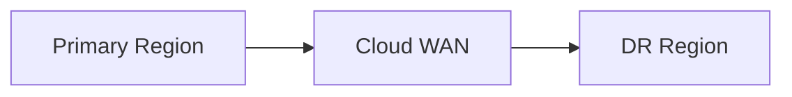
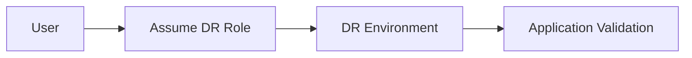

# Disaster Recovery Account

## Overview
Secondary-region recovery environment.

## Recovery Models
Pilot light · Warm standby · Multi-site (chosen per application tier)

## Architecture

## CIDR
10.40.0.0/16

## Replication
- RDS cross-region read replica
- S3 cross-region replication
- Backup vault replication
- Route 53 failover

## DR Testing

## Documents
[DR-VPC](DR-VPC.md) · [Backup Replication](Backup-Replication.md) · [Failover Design](Failover-Design.md)
