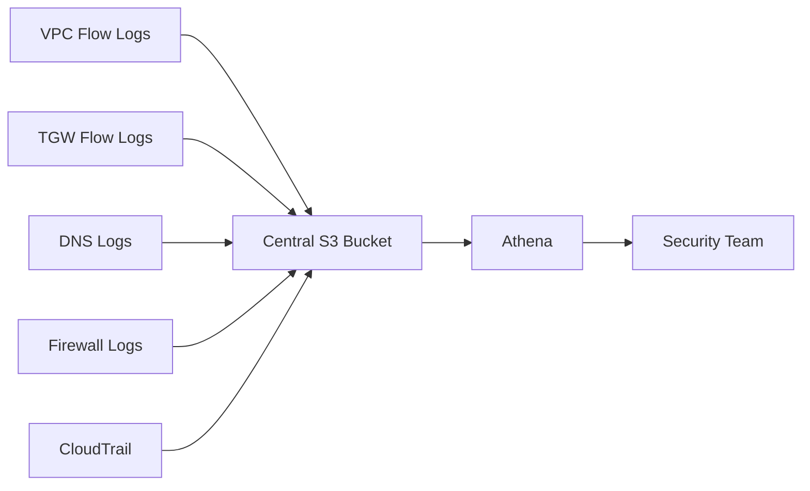

# Log Archive Account

## Overview
Centralized immutable logging account.

## Architecture

## Log Sources
CloudTrail · AWS Config · VPC Flow Logs · TGW Flow Logs · Route 53 Query Logs · AWS Network Firewall Logs

## Security
- S3 Object Lock
- KMS encryption
- MFA Delete
- Cross-account read access

See [Centralized-Logging](Centralized-Logging.md).
