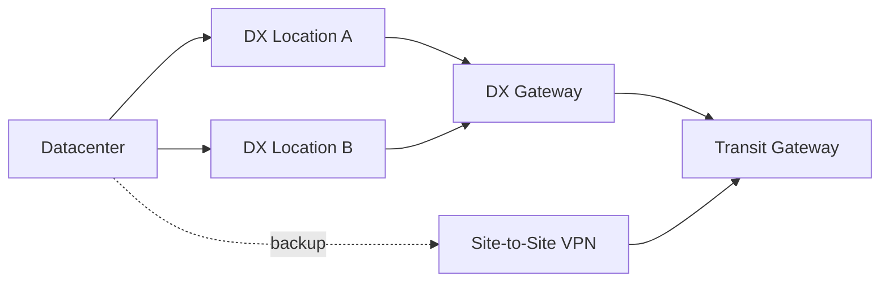

# Direct Connect

- Primary hybrid path from the datacenter to AWS via a Direct Connect Gateway associated to the Transit Gateway.
- Redundant connections at diverse locations are recommended for the production tier.
- Site-to-Site VPN acts as the encrypted backup path, also terminating on the TGW.
- MACsec or IPsec over DX is recommended where encryption in transit is required.
- BGP communities and AS-path prepending control path preference between DX and VPN.

