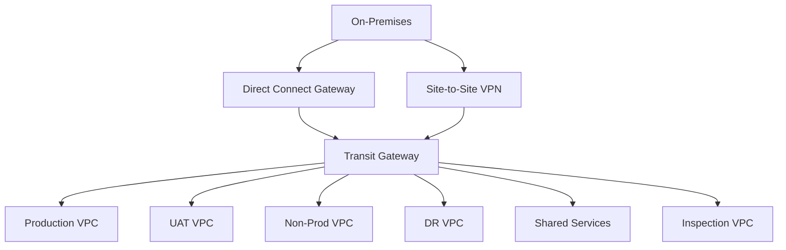

# Enterprise Network Account

## Overview
Provides centralized connectivity services across the AWS Organization.

## Responsibilities
- AWS Transit Gateway
- Direct Connect
- Cloud WAN
- Site-to-Site VPN
- AWS IPAM
- Route 53 Resolver
- AWS RAM sharing
- Network Manager

## Architecture

## Transit Gateway Route Tables
| Route Table | Purpose |
|---|---|
| TGW-RT-PROD | Production |
| TGW-RT-UAT | UAT |
| TGW-RT-NONPROD | Development |
| TGW-RT-SHARED | Shared Services |
| TGW-RT-SECURITY | Inspection |
| TGW-RT-ONPREM | Hybrid connectivity |
| TGW-RT-DR | Disaster Recovery |

## Key Design Decisions
- Single TGW per region
- Shared using AWS RAM
- Dedicated TGW attachment subnets
- Appliance mode enabled for inspection
- Route isolation between environments

## Documents
[Transit Gateway](Transit-Gateway.md) · [Direct Connect](Direct-Connect.md) · [Cloud WAN](CloudWAN.md) · [IPAM](IPAM.md) · [Routing Strategy](Routing-Strategy.md)
