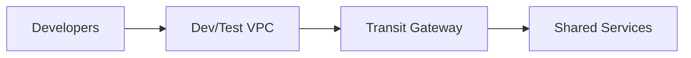

# Non-Production Account

## Purpose
Development and sandbox environments.

## Architecture

## CIDR
10.30.128.0/17

## Contains
Developer sandboxes · Feature testing · Training labs · Automation testing

## Security Controls
- Internet through the inspection firewall
- No Production access

See [Dev-Test-Network](Dev-Test-Network.md).
