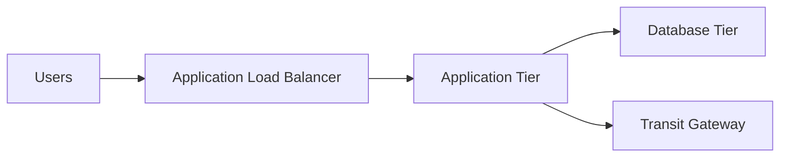

# Production Account

## Overview
Mission-critical workloads: Core Banking, Payment Systems, ATM Services, Customer Portals.

## Architecture

## CIDR
10.10.0.0/16

## Security Controls
- No direct internet access
- Egress via Inspection VPC
- SCP protection
- Centralized logging
- IAM least privilege

## Connectivity
| Allowed | Denied |
|---|---|
| Shared Services | UAT |
| On-Premises | Test |
| DR environment | Non-Prod |

## Documents
[Production VPC](Production-VPC.md) · [Routing](Routing.md) · [Security Controls](Security-Controls.md)
