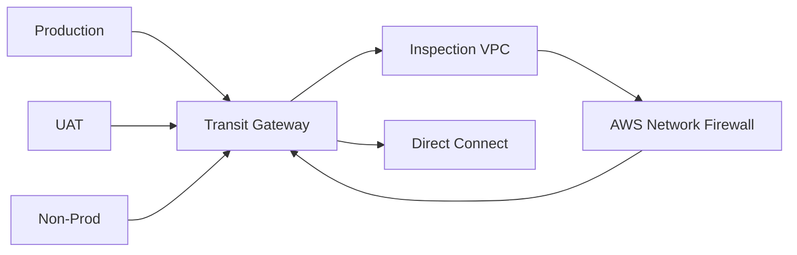
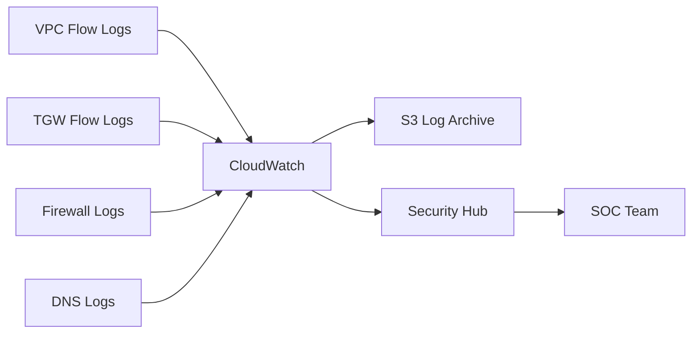

# Enterprise Security Account

## Overview
Centralized inspection and security operations account.

## Responsibilities
- AWS Network Firewall
- Security Hub
- GuardDuty
- Inspector
- Macie
- SOC monitoring
- Firewall logging

## Inspection Architecture

> The source design showed GWLB in front of Network Firewall. Network Firewall endpoints are deployed directly in the Inspection VPC; GWLB is only needed for third-party appliances. Adjust if you use partner firewalls.

## Security Services
Security Hub · GuardDuty · Macie · Inspector · Detective · IAM Access Analyzer · AWS WAF · AWS Shield Advanced

## Logging Flow

## Documents
[Inspection VPC](Inspection-VPC.md) · [Network Firewall](AWS-Network-Firewall.md) · [Security Hub](Security-Hub.md) · [GuardDuty](GuardDuty.md) · [WAF & Shield](WAF-Shield.md) · [SOC Monitoring](SOC-Monitoring.md)
