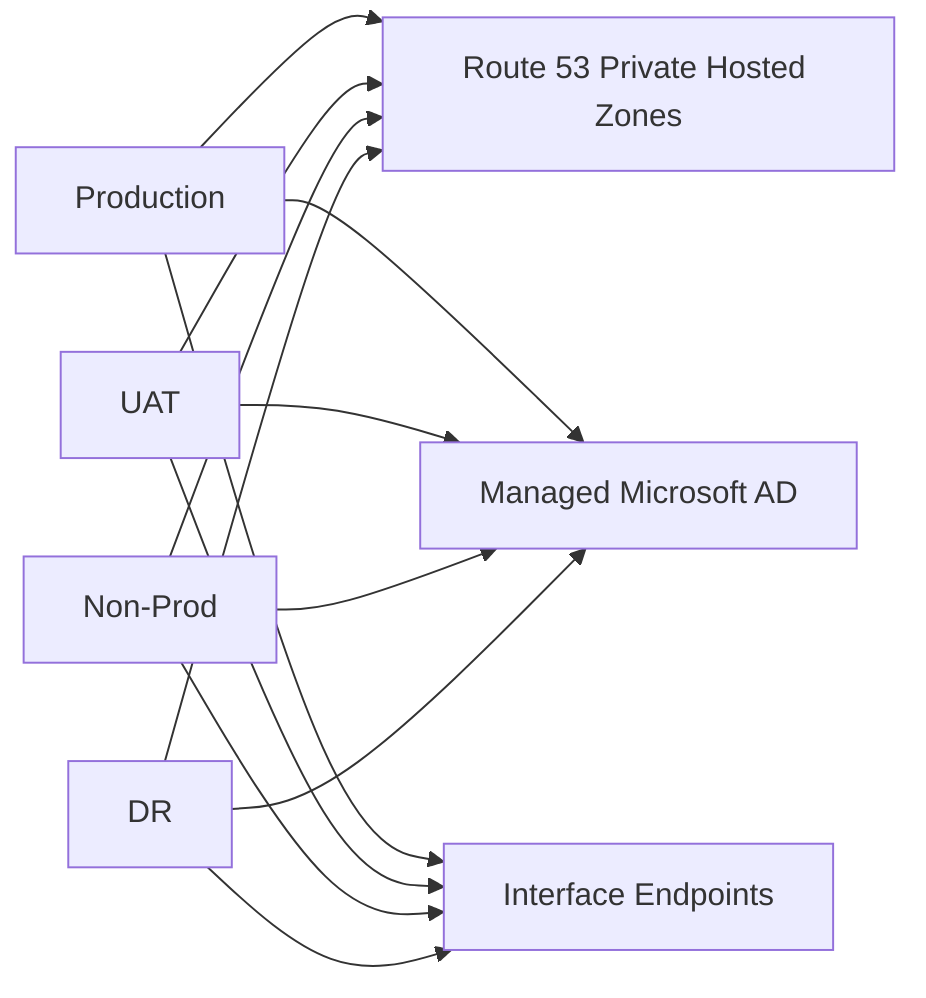

# Shared Services Account

## Overview
Provides common enterprise services shared across AWS accounts.

## Services
Active Directory · DNS · Interface Endpoints · Private Hosted Zones · Backup Services

## Architecture

## Interface Endpoints
SSM · KMS · Secrets Manager · STS · CloudWatch · ECR · SNS · SQS · Lambda

## DNS Architecture
- **Inbound Resolver:** receives DNS requests from on-premises.
- **Outbound Resolver:** forwards DNS requests to on-premises DNS infrastructure.

## Documents
[DNS Architecture](DNS-Architecture.md) · [Active Directory](Active-Directory.md) · [Interface Endpoints](Interface-Endpoints.md) · [PrivateLink](PrivateLink.md) · [Backup Services](Backup-Services.md)
