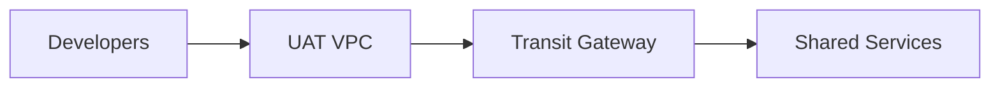

# UAT Account

## Purpose
User Acceptance Testing.

## Architecture

## CIDR
10.30.0.0/17

## Use Cases
Regression testing · Performance testing · Integration testing · Release validation

## Restrictions
No access to Production workloads.

See [UAT-Network](UAT-Network.md).
