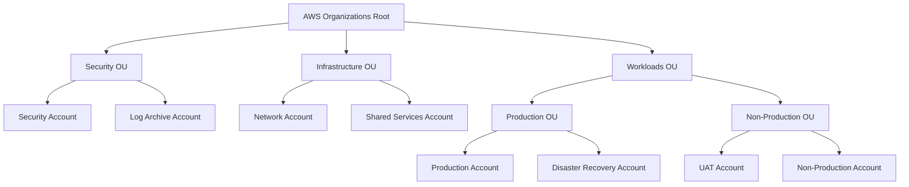
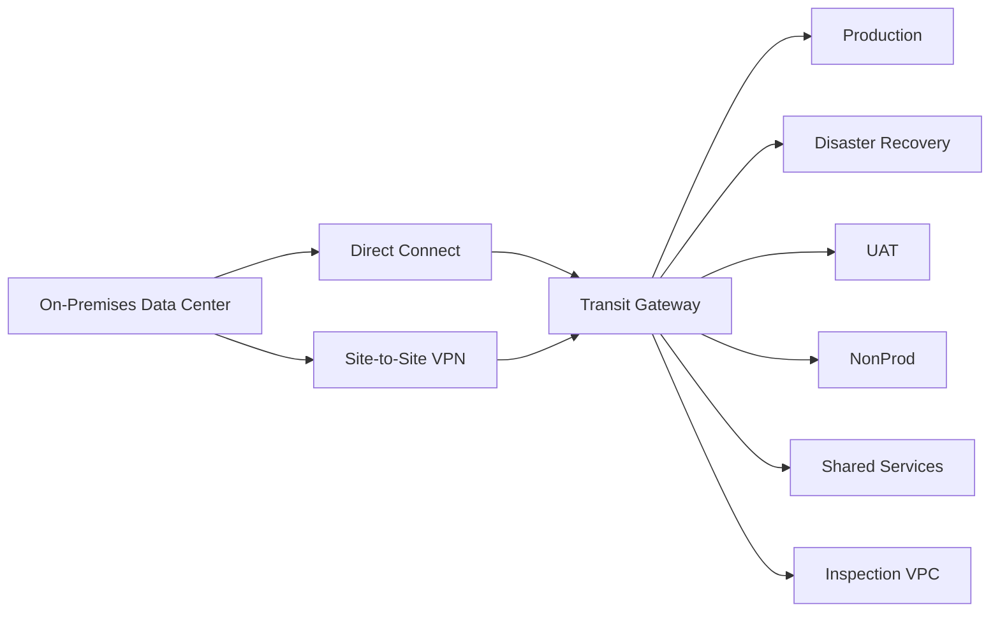
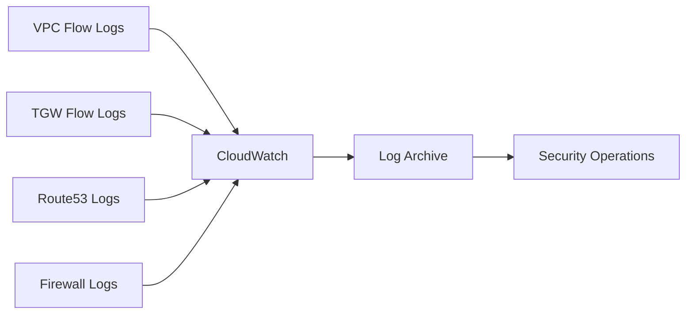

# Landing Zone Design

## Overview

This landing zone provides a secure, scalable, and governed AWS foundation for enterprise workloads. The design follows a multi-account operating model using AWS Control Tower (or an equivalent governance framework) and separates networking, security, shared services, production workloads, non-production workloads, disaster recovery, and centralized logging into dedicated AWS accounts.

The primary design goals are:

- Strong security boundaries through account isolation
- Centralized governance and compliance controls
- Consistent network architecture across all environments
- Centralized visibility and logging
- Support for hybrid cloud connectivity
- Scalability to hundreds of AWS accounts

---

## Organizational Structure



---

## Account Model

| Account | Organizational Unit | Primary Responsibilities |
|----------|----------|----------|
| Network | Infrastructure OU | Transit Gateway, Cloud WAN, Direct Connect, VPN, IPAM |
| Shared Services | Infrastructure OU | DNS, Active Directory, Route 53, Interface Endpoints |
| Security | Security OU | Security Hub, GuardDuty, Inspector, Incident Response |
| Log Archive | Security OU | Centralized log storage and compliance retention |
| Production | Production OU | Mission-critical business workloads |
| Disaster Recovery | Production OU | Production recovery environment |
| UAT | Non-Production OU | User acceptance and integration testing |
| Non-Production | Non-Production OU | Development and sandbox workloads |

---

## Landing Zone Principles

### Separation of Duties

Responsibilities are separated between infrastructure, security, and application teams.

- Network team owns connectivity and routing.
- Security team owns monitoring and compliance.
- Application teams own workloads only.
- Shared services team owns platform services consumed by workloads.

---

### Account Isolation

AWS accounts represent the primary security boundary.

Benefits include:

- Reduced blast radius
- Independent IAM administration
- Independent quotas and service limits
- Controlled cross-account access

---

### Infrastructure as Code

All infrastructure is deployed through:

- Terraform
- GitHub Actions or CI/CD pipelines
- Pull request approval workflows
- Version control and change management

Manual production changes are prohibited.

---

## Enterprise Network Architecture



---

## Connectivity Strategy

### Hybrid Connectivity

On-premises connectivity is provided through:

- AWS Direct Connect
- Site-to-Site VPN (backup path)
- BGP dynamic routing
- Transit Gateway integration

### AWS-to-AWS Connectivity

Connectivity between AWS environments is provided through:

- Transit Gateway attachments
- Dedicated TGW route tables
- Route propagation controls
- Blackhole routes for isolation requirements

---

## Security Architecture

### Centralized Inspection

All internet egress and hybrid traffic is inspected through the Security Account.

```text
Production
    ↓
Transit Gateway
    ↓
Inspection VPC
    ↓
AWS Network Firewall / Third-Party Firewall
    ↓
Internet or On-Premises
```

### Traffic Isolation

The design enforces:

- Production isolated from Non-Production
- Dedicated TGW route tables
- Explicit route propagation
- Blackhole routes between environments

---

## Shared Services

The Shared Services Account provides enterprise services consumed by all workload accounts.

Services include:

- Route 53 Private Hosted Zones
- Route 53 Resolver Endpoints
- Active Directory
- Shared Interface Endpoints
- Secrets Management
- KMS Integration

Enterprise endpoints include:

- SSM
- STS
- CloudWatch
- KMS
- Secrets Manager
- ECR

---

## Centralized Logging

All accounts forward operational and security logs into the Log Archive Account.



---

## Governance

Governance is enforced through:

- AWS Organizations
- AWS Control Tower
- Service Control Policies (SCPs)
- IAM Identity Center
- Mandatory logging
- Mandatory encryption
- Approved AWS Regions

Dedicated SCPs are applied to:

- Security OU
- Infrastructure OU
- Production OU
- Non-Production OU

---

## Disaster Recovery Strategy

The Disaster Recovery account resides within the Production OU to inherit the same security and governance controls.

Recovery capabilities include:

- Cross-Region backups
- Database replication
- Route 53 failover
- Pilot Light deployment
- Warm Standby architecture

---

## Design Benefits

- Enterprise-scale multi-account architecture
- Centralized governance and visibility
- Secure hybrid connectivity
- Production and non-production isolation
- Centralized inspection and logging
- Cloud-native disaster recovery
- Automated infrastructure provisioning
- Scalable foundation for future growth
