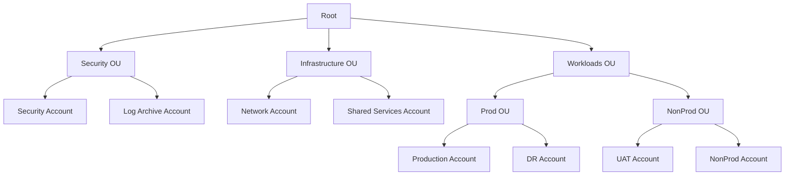
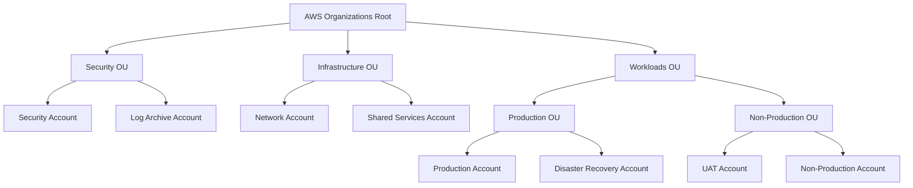

# OU Structure

# OU Structure

# OU Structure

## Overview

The AWS Organization is structured to separate security, infrastructure, and workload responsibilities while enforcing governance through Service Control Policies (SCPs), centralized logging, and account-level isolation.

---

## Organizational Hierarchy

---

## OU Responsibilities

### Security OU

Responsible for enterprise security operations, threat detection, compliance monitoring, and centralized log retention.

**Security Account**
- Security Hub
- GuardDuty
- Inspector
- Detective
- Incident Response tooling

**Log Archive Account**
- CloudTrail logs
- AWS Config history
- VPC Flow Logs
- Transit Gateway Flow Logs
- DNS Query Logs
- Firewall logs

---

### Infrastructure OU

Provides shared networking and platform services for the entire organization.

**Network Account**
- Transit Gateway
- Direct Connect Gateway
- Site-to-Site VPN
- Cloud WAN
- AWS RAM
- AWS IPAM
- Route 53 Resolver

**Shared Services Account**
- Active Directory
- Enterprise DNS
- Route 53 Private Hosted Zones
- Interface Endpoints
- Shared Management Services

---

### Production OU

Contains business-critical environments subject to the highest level of governance.

**Production Account**
- Production workloads
- Mission-critical applications
- Customer-facing services

**Disaster Recovery Account**
- Secondary Region recovery environment
- Backup and replication targets
- DR testing and failover operations

---

### Non-Production OU

Provides isolated environments for testing and development activities.

**UAT Account**
- User Acceptance Testing
- Integration Testing
- Release Validation

**Non-Production Account**
- Development
- Sandbox workloads
- Automation testing
- Proof-of-concept environments

---

## Design Notes

- DR resides within the Production OU to inherit the same production-grade SCPs and security controls.
- UAT and Non-Production environments share an OU but remain separate AWS accounts and separate CIDR allocations.
- Security and logging services are isolated from workload accounts.
- Networking services are centrally managed within the Network Account and shared through AWS RAM.
- All infrastructure is deployed through Terraform and CI/CD pipelines.
- Centralized logging is enforced across every account.

---

## Related Documents

- Landing-Zone-Design.md
- SCP-Strategy.md
- CIDR-Strategy.md
- Transit-Gateway-Strategy.md
- Enterprise-DNS-Strategy.md
