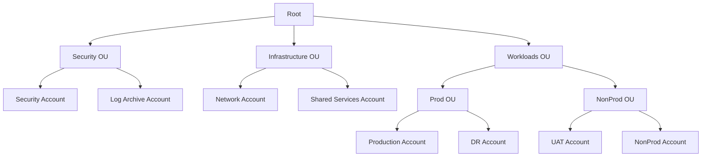
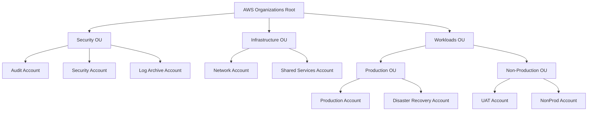

# OU Structure

# OU Structure

## Overview

The AWS Organization is structured to separate security, infrastructure, and workload responsibilities while enforcing governance through AWS Organizations, Service Control Policies (SCPs), and centralized logging.

Key objectives:

- Separate security, networking, and application ownership.
- Apply different guardrails to production and non-production environments.
- Centralize logging, monitoring, and compliance reporting.
- Support hybrid connectivity, disaster recovery, and future account growth.
- Minimize blast radius through account-level isolation.

---

## Organizational Structure

---

## Security OU

The Security OU contains the accounts responsible for monitoring, compliance, threat detection, and log retention.

### Audit Account

Responsibilities:

- AWS Config compliance reporting
- Security assessments
- Cross-account read-only auditing
- Compliance evidence collection

### Security Account

Responsibilities:

- Security Hub
- GuardDuty
- Detective
- Amazon Inspector
- Macie
- Incident response tooling
- Centralized security operations

### Log Archive Account

Responsibilities:

- CloudTrail log storage
- AWS Config history
- VPC Flow Logs
- Transit Gateway Flow Logs
- Route 53 DNS query logs
- AWS Network Firewall logs

All logs are retained in immutable storage and protected from modification.

---

## Infrastructure OU

The Infrastructure OU hosts shared platform services consumed by workload accounts.

### Network Account

Responsibilities:

- AWS Transit Gateway
- Direct Connect Gateway
- Site-to-Site VPN
- Cloud WAN
- AWS IPAM
- Route 53 Resolver
- AWS RAM shares
- Network Manager

The Network Account owns routing policies and hybrid connectivity.

### Shared Services Account

Responsibilities:

- Route 53 Private Hosted Zones
- Route 53 Resolver Rules
- Microsoft Active Directory
- Enterprise DNS services
- Shared interface endpoints
- Centralized management services

Examples of shared endpoints:

- Systems Manager (SSM)
- KMS
- Secrets Manager
- CloudWatch
- ECR
- STS

---

## Production OU

Contains mission-critical environments that require the highest level of governance.

### Production Account

Hosts production workloads and business-critical applications.

Examples:

- Core Banking
- Airline Reservation Systems
- Payment Platforms
- Customer Applications
- Enterprise APIs

### Disaster Recovery Account

Hosts production recovery environments in a secondary AWS Region.

The DR account resides under the Production OU so it inherits the same production-grade SCPs and security requirements.

Recovery models may include:

- Pilot Light
- Warm Standby
- Active/Passive
- Active/Active

---

## Non-Production OU

Contains lower-risk environments used for testing and development.

### UAT Account

Purpose:

- User Acceptance Testing
- Integration Testing
- Performance Testing
- Release Validation

### NonProd Account

Purpose:

- Development
- Sandbox Environments
- Automation Testing
- Proof of Concepts

Non-production environments are isolated from Production through account boundaries, TGW route segregation, and SCP controls.

---

## Governance Model

### Centralized Identity

User access is provided through:

- AWS IAM Identity Center
- Corporate Identity Provider (Microsoft Entra ID / Active Directory)

### Service Control Policies

Guardrails are applied at the OU level.

Examples:

**Production OU**

- Deny unauthorized internet gateways
- Deny deletion of CloudTrail
- Restrict AWS Regions
- Enforce encryption controls

**Non-Production OU**

- Allow controlled experimentation
- Prevent access to production resources
- Require logging and tagging standards

### Logging Standards

All accounts send logs to the Log Archive Account.

Sources include:

- CloudTrail
- AWS Config
- VPC Flow Logs
- Transit Gateway Flow Logs
- Route 53 Query Logs
- Firewall Logs

---

## Design Principles

- Separation of duties between networking, security, and application teams.
- Production and non-production workloads remain isolated.
- Shared services are centralized and reusable.
- Hybrid connectivity is managed through the Network Account.
- Security monitoring is centralized in the Security OU.
- Logging is centralized in the Log Archive Account.
- Account boundaries are used as the primary security boundary.
- All infrastructure is deployed through Infrastructure as Code (Terraform).

---

## Future Expansion

Additional OUs can be added as the organization grows, including:

- Sandbox OU
- Data Analytics OU
- Machine Learning OU
- Acquisitions OU
- Regional Workload OUs

The landing zone is designed to scale to hundreds of AWS accounts while maintaining centralized governance and operational consistency.
