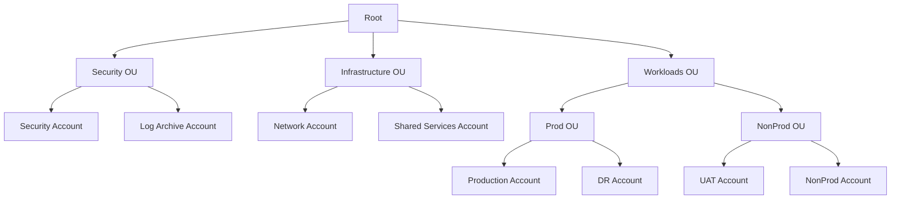

# OU Structure

## Notes
- DR sits with Production so it inherits the same production-grade SCPs.
- UAT and NonProd share an OU but remain separate accounts and separate CIDRs.
- See [SCP-Strategy](SCP-Strategy.md) for guardrails attached at each level.
