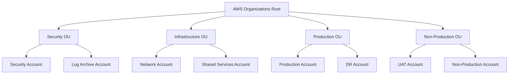

# SCP Strategy

## Overview

Service Control Policies (SCPs) provide preventive guardrails across the AWS Organization. They define the maximum permissions available to accounts within an Organizational Unit (OU) and complement IAM policies, which grant permissions to users, groups, and roles.

The objective of this strategy is to enforce security, compliance, networking standards, and operational governance consistently across all AWS accounts.

---

## Governance Principles

### Preventive Controls

SCPs prevent actions before they occur.

Examples:

- Blocking creation of unauthorized internet gateways
- Preventing deletion of audit logs
- Restricting deployments to approved regions
- Protecting centralized networking components

### Least Privilege

SCPs do not grant permissions.

Instead:

- SCPs define the maximum available permissions.
- IAM policies grant the required permissions.
- Both controls must allow an action for it to succeed.

### Centralized Governance

Enterprise standards are defined once and inherited through AWS Organizations.

Benefits include:

- Consistent security posture
- Reduced operational risk
- Simplified compliance audits
- Reduced administrative overhead

---

## SCP Hierarchy

SCPs attached at higher levels are inherited by child OUs and accounts.

---

## Enterprise SCP Guardrails

| SCP | Applied To | Purpose |
|-------|-------|-------|
| Deny Internet Gateway Creation | Workload OUs | Forces internet egress through centralized inspection |
| Deny Disabling CloudTrail | All OUs | Protects audit records |
| Deny Disabling AWS Config | All OUs | Maintains compliance visibility |
| Deny Disabling GuardDuty | All OUs | Prevents loss of threat detection |
| Approved Regions Only | All OUs | Restricts workloads to approved AWS Regions |
| Deny Transit Gateway Modifications | Workload OUs | Network routing controlled by Network Account |
| Deny Log Archive Changes | Security OU | Protects immutable logging |
| Deny Root User Operations | All OUs | Root account limited to break-glass use |
| Require Encryption | All OUs | Enforces cryptographic controls |
| Mandatory Tagging Enforcement | All OUs | Supports governance and cost allocation |

---

## Production OU Controls

The Production OU contains mission-critical workloads and therefore receives the strictest controls.

### Production Restrictions

- Internet Gateway creation prohibited
- CloudTrail must remain enabled
- AWS Config must remain enabled
- Encryption mandatory
- Approved Regions only
- Transit Gateway routing controlled centrally
- Security logging mandatory

Accounts Covered:

- Production Account
- Disaster Recovery Account

Because the Disaster Recovery account resides within the Production OU, it inherits identical governance controls.

---

## Non-Production OU Controls

The Non-Production OU supports development, testing, and validation.

Controls remain strong but allow greater operational flexibility.

Examples:

- Production access prohibited
- Logging remains mandatory
- Encryption remains mandatory
- Region restrictions still enforced
- Testing resources permitted

Accounts Covered:

- UAT Account
- Non-Production Account

---

## Infrastructure OU Controls

The Infrastructure OU contains shared platform services.

Additional controls include:

### Network Account

- Only designated network administrators may modify:
  - Transit Gateway
  - Direct Connect Gateway
  - Cloud WAN
  - Route Tables
  - AWS IPAM

### Shared Services Account

- DNS changes restricted
- Resolver endpoints protected
- Private Hosted Zones protected
- Shared endpoint services controlled

---

## Security OU Controls

The Security OU protects monitoring and audit capabilities.

### Security Account

Protected Services:

- Security Hub
- GuardDuty
- Inspector
- Detective
- Incident Response tooling

### Log Archive Account

Protected Resources:

- S3 log buckets
- CloudTrail archives
- Config snapshots
- Flow logs
- Object Lock configuration

Deletion or modification of audit evidence is prohibited.

---

## Break-Glass Access

Emergency administrative access follows a documented break-glass process.

Requirements:

- MFA enabled
- Security approval required
- Usage fully logged
- Post-incident review required

Break-glass procedures are documented within the repository runbooks.

---

## Testing Strategy

Before deploying SCPs to Production:

1. Create policy in a Sandbox or Non-Production OU.
2. Validate expected workload functionality.
3. Review CloudTrail events.
4. Confirm operational teams can perform required tasks.
5. Deploy through Infrastructure as Code.
6. Monitor for unintended denials.

Production SCP changes should always follow change-control procedures.

---

## Design Benefits

- Consistent security enforcement
- Reduced risk of accidental exposure
- Protected audit evidence
- Controlled network architecture
- Compliance-ready governance model
- Scalable multi-account management
- Clear separation of duties

The SCP model ensures that security governance is applied uniformly across the organization while allowing individual teams to manage workloads within approved boundaries.
