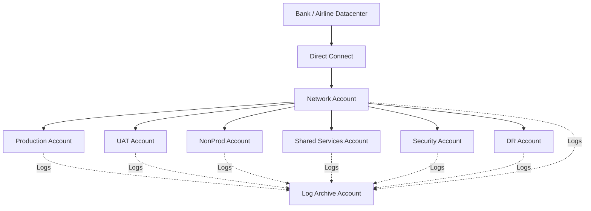

# AWS Advanced Network Security Platform

Enterprise multi-account AWS network and security reference architecture for regulated workloads (banking / airline). Hub-and-spoke connectivity through AWS Transit Gateway, centralized inspection, shared services, immutable log archive, and a cross-region DR account.

## What This Project Shows

A design for an AWS setup where a bank or airline runs many workloads safely across many AWS accounts. In simple terms:

- One **Network account** connects everything: the datacenter, production, test and disaster recovery.
- Every connection between environments goes through a **central firewall** in the Security account.
- Production, UAT and Dev are **kept apart** so a mistake in test does not reach production.
- **All logs** go to a locked-down account where logs cannot be edited or deleted.
- A **second region** is ready to take over if the main region fails.

## Highlights

- 8 AWS accounts, each with its own README and design notes
- Hub-and-spoke network using AWS Transit Gateway with 7 separate route tables
- Hybrid connectivity: Direct Connect with VPN as backup
- Central inspection with AWS Network Firewall
- Shared DNS, Active Directory and private endpoints
- Disaster recovery in a second region over Cloud WAN
- Immutable log archive (S3 Object Lock, KMS, MFA Delete)
- Non-overlapping IP plan managed with AWS IPAM
- Working Terraform module for the Transit Gateway (see [Terraform](Terraform/README.md))

## Skills Demonstrated

AWS multi-account design · Transit Gateway · Direct Connect and VPN · AWS Network Firewall · AWS Cloud WAN · Route 53 Resolver and private DNS · AWS Organizations and SCPs · Security Hub and GuardDuty · Disaster recovery design · IP address planning · Terraform

## High-Level Architecture



## Repository Structure

```text
aws-advanced-network-security-restructured/
├── README.md
├── Organization/        # Landing zone, OU structure, CIDR and SCP strategy
├── Accounts/            # One folder per AWS account, each with its own README
│   ├── Network-Account/
│   ├── Security-Account/
│   ├── Shared-Services-Account/
│   ├── Production-Account/
│   ├── UAT-Account/
│   ├── NonProd-Account/
│   ├── DR-Account/
│   └── LogArchive-Account/
├── Terraform/           # Infrastructure as code (Transit Gateway module and example)
├── Diagrams/            # Exported / source diagrams
└── Docs/                # Runbooks and supporting documentation
```

## Accounts

| Account | Purpose | CIDR | Docs |
|---|---|---|---|
| Network | Connectivity hub: TGW, Direct Connect, Cloud WAN, VPN, IPAM, Route 53 Resolver | 10.0.0.0/16 (proposed) | [README](Accounts/Network-Account/README.md) |
| Security | Inspection VPC, Network Firewall, Security Hub, GuardDuty, WAF/Shield, SOC | 10.1.0.0/16 (proposed) | [README](Accounts/Security-Account/README.md) |
| Shared Services | Managed AD, DNS, interface endpoints, PrivateLink, backup | 10.2.0.0/16 (proposed) | [README](Accounts/Shared-Services-Account/README.md) |
| Production | Mission-critical workloads (core banking, payments, ATM, portals) | 10.10.0.0/16 | [README](Accounts/Production-Account/README.md) |
| UAT | User acceptance, regression, performance, release validation | 10.30.0.0/17 | [README](Accounts/UAT-Account/README.md) |
| NonProd | Development, sandboxes, training labs | 10.30.128.0/17 | [README](Accounts/NonProd-Account/README.md) |
| DR | Secondary-region recovery environment | 10.40.0.0/16 | [README](Accounts/DR-Account/README.md) |
| Log Archive | Immutable centralized logging | 10.5.0.0/16 (proposed) | [README](Accounts/LogArchive-Account/README.md) |

> CIDRs marked "proposed" were not in the source design and are suggested to complete the plan. Validate against your IPAM and on-premises ranges. See [CIDR-Strategy](Organization/CIDR-Strategy.md).

## Core Design Principles

- Single Transit Gateway per region, shared via AWS RAM
- Route-table isolation between environments (Production never reaches UAT / NonProd)
- All internet egress and inter-environment traffic inspected centrally
- Centralized, immutable logging (S3 Object Lock, KMS, MFA Delete)
- Preventive guardrails through SCPs
- Cross-region DR over Cloud WAN

## Key Design Decisions (in plain English)

| Decision | Why |
|---|---|
| One Transit Gateway per region, shared with AWS RAM | One central place to control routing, no copies per account |
| Separate route table for each environment | Production, UAT and Dev cannot reach each other |
| All outbound and cross-environment traffic goes through the Inspection VPC | One place to filter and log traffic |
| Appliance mode on the Inspection VPC | Traffic goes through the same firewall both ways |
| Logs sent to a separate Log Archive account with Object Lock | Logs cannot be changed or deleted, even by an admin |
| SCPs on the organization | Blocks risky actions before they can happen |
| DR in another region, linked with Cloud WAN | The business keeps running if the main region fails |

## Getting Started

1. Read [Landing-Zone-Design](Organization/Landing-Zone-Design.md) and [OU-Structure](Organization/OU-Structure.md).
2. Review [CIDR-Strategy](Organization/CIDR-Strategy.md) and [SCP-Strategy](Organization/SCP-Strategy.md).
3. Walk the account docs, starting with the Network Account.
4. See [Terraform](Terraform/README.md) for the Transit Gateway module and example.

## Related Documentation

More design work from the same author is in this repository:

- [Project design documents (Projects 1-7)](aws-advanced-network-security/): hub-and-spoke reference architecture, hybrid connectivity, centralized security, DNS and multi-account strategy, network automation, SD-WAN and Zscaler, and FinOps
- [Hands-on project labs](Project/): Transit Gateway hybrid, VPN and Direct Connect, Zero Trust with PrivateLink, microservices with ALB, and multi-region Global Accelerator

## Author

**Vanchinathan**
GitHub: [vanchinathan-Cloud](https://github.com/vanchinathan-Cloud)
LinkedIn: _add your LinkedIn URL here_
