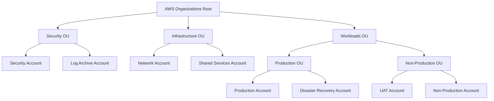
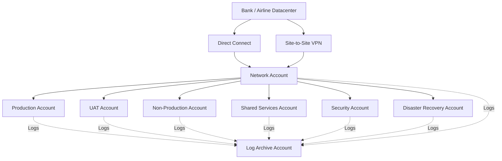

# AWS Advanced Network Security Platform

Enterprise multi-account AWS network and security reference architecture for regulated industries such as banking, financial services, insurance, healthcare, and airlines.

The platform uses a hub-and-spoke design built around AWS Transit Gateway, centralized security inspection, shared platform services, immutable logging, and cross-region disaster recovery. The design emphasizes governance, security, operational resilience, and scalability using AWS Organizations, Control Tower, and Infrastructure as Code.

---

# What This Project Demonstrates

This repository showcases how a large enterprise can securely operate workloads across multiple AWS accounts while maintaining centralized governance and network controls.

In simple terms:

- A dedicated **Network Account** provides centralized connectivity between AWS, on-premises datacenters, and disaster recovery environments.
- A dedicated **Security Account** hosts centralized inspection, monitoring, and threat detection services.
- A dedicated **Shared Services Account** provides enterprise DNS, Active Directory, and shared platform services.
- Production, UAT, and Non-Production workloads are isolated through AWS accounts, Transit Gateway route tables, and firewall policies.
- Centralized logging ensures security and operational events cannot be altered or deleted during the retention period.
- A secondary region is available for disaster recovery and business continuity.

---

# Landing Zone Governance

The environment is governed through centralized controls before workloads are deployed.

Core governance services include:

- AWS Organizations
- AWS Control Tower
- IAM Identity Center
- Service Control Policies (SCPs)
- AWS Resource Access Manager (RAM)
- AWS IP Address Manager (IPAM)
- Centralized Logging
- Infrastructure as Code (Terraform)

The landing zone applies preventive guardrails, centralized identity management, and account-level isolation across the organization.

---

# Enterprise Services

- AWS Organizations
- AWS Control Tower
- IAM Identity Center
- AWS Transit Gateway
- AWS Cloud WAN
- Direct Connect
- Site-to-Site VPN
- Route 53 Resolver
- Route 53 Private Hosted Zones
- AWS RAM
- AWS IPAM
- AWS Network Firewall
- AWS Security Hub
- Amazon GuardDuty
- AWS Config
- CloudTrail
- Amazon S3 Object Lock
- AWS KMS

---

# AWS Organization Structure



---

# High-Level Network Architecture



A static copy of this diagram is available in:

```text
Diagrams/high-level-architecture.png
```

---

# Architecture Highlights

- Eight dedicated AWS accounts
- Single Transit Gateway per region
- Seven Transit Gateway route tables
- Hybrid connectivity using Direct Connect and VPN
- Centralized security inspection
- Shared DNS and Active Directory services
- Cross-region disaster recovery
- Immutable centralized logging
- Centralized IP management using AWS IPAM
- Infrastructure as Code using Terraform

---

# Repository Structure

```text
aws-advanced-network-security/

├── README.md

├── Organization/
│   ├── Landing-Zone-Design.md
│   ├── OU-Structure.md
│   ├── SCP-Strategy.md
│   └── CIDR-Strategy.md

├── Accounts/
│   ├── Network-Account/
│   ├── Security-Account/
│   ├── Shared-Services-Account/
│   ├── Production-Account/
│   ├── UAT-Account/
│   ├── NonProd-Account/
│   ├── DR-Account/
│   └── LogArchive-Account/

├── Terraform/

├── Diagrams/

├── Docs/

├── Project/

└── aws-advanced-network-security/
```

---

# Account Overview

| Account | Purpose | CIDR |
|----------|----------|----------|
| Network | Transit Gateway, Direct Connect, VPN, Cloud WAN, IPAM, Route 53 Resolver | 10.60.0.0/17 |
| Security | Inspection VPC, AWS Network Firewall, Security Hub, GuardDuty | 10.50.0.0/17 |
| Shared Services | DNS, Active Directory, Interface Endpoints, PrivateLink | 10.20.0.0/17 |
| Production | Mission-critical workloads | 10.10.0.0/16 |
| UAT | User acceptance and pre-production testing | 10.30.0.0/17 |
| Non-Production | Development and sandbox environments | 10.30.128.0/17 |
| Disaster Recovery | Secondary region recovery environment | 10.40.0.0/16 |
| Log Archive | Centralized immutable logging | Dedicated logging account |

Refer to **CIDR-Strategy.md** for detailed allocation policies.

---

# Core Design Principles

## Centralized Connectivity

A single Transit Gateway is deployed per AWS Region and shared across workload accounts using AWS RAM.

## Environment Isolation

Production, UAT, and Non-Production environments remain isolated using:

- Separate AWS accounts
- Separate Transit Gateway route tables
- Firewall inspection policies
- SCP governance

## Centralized Inspection

Internet-bound traffic and designated east-west traffic are inspected through a centralized Inspection VPC hosted in the Security Account.

## Immutable Logging

Logs are stored centrally using:

- S3 Object Lock
- KMS Encryption
- MFA Delete
- Cross-account log delivery

## Infrastructure as Code

All infrastructure is managed through:

- Terraform
- Pull Requests
- CI/CD Pipelines
- Change Management Controls

---

# Key Architecture Decisions

| Decision | Rationale |
|------------|------------|
| Single Transit Gateway per Region | Simplifies governance and routing management |
| AWS RAM for sharing | Eliminates duplicated network infrastructure |
| Dedicated route table per environment | Enables route-level segmentation |
| Centralized Inspection VPC | Consistent security controls and monitoring |
| Appliance Mode enabled | Ensures symmetric traffic flows |
| Centralized Log Archive | Supports compliance and forensic investigations |
| SCP Guardrails | Prevent risky changes before they occur |
| Cross-Region DR | Improves resilience and business continuity |

---

# Disaster Recovery Strategy

The Disaster Recovery Account resides in a secondary AWS Region and inherits production governance controls.

Recovery capabilities include:

- Cross-region database replication
- Route 53 failover
- Backup replication
- Pilot Light deployment
- Warm Standby architecture
- Cloud WAN connectivity between regions

---

# Skills Demonstrated

- AWS Organizations
- AWS Control Tower
- Transit Gateway
- AWS RAM
- Direct Connect
- Site-to-Site VPN
- AWS IPAM
- AWS Cloud WAN
- Route 53 Resolver
- AWS Network Firewall
- Security Hub
- GuardDuty
- AWS Organizations SCPs
- Multi-Account Architecture
- Disaster Recovery Design
- Infrastructure as Code
- Terraform
- Enterprise Network Security

---

# Getting Started

1. Review **Landing-Zone-Design.md**
2. Review **OU-Structure.md**
3. Review **CIDR-Strategy.md**
4. Review **SCP-Strategy.md**
5. Review the account-specific documentation
6. Review runbooks under **Docs/**
7. Explore Terraform modules and examples

---

# Related Documentation

## Organization

- Landing Zone Design
- OU Structure
- CIDR Strategy
- SCP Strategy

## Account Documentation

- Network Account
- Security Account
- Shared Services Account
- Production Account
- UAT Account
- Non-Production Account
- Disaster Recovery Account
- Log Archive Account

## Operations

- DR Failover Runbook
- Break-Glass Access Runbook
- Security Incident Response
- Transit Gateway Troubleshooting

## Projects

- Hybrid Connectivity
- Transit Gateway Architectures
- Multi-Region DR
- DNS Design
- Security Inspection Patterns
- Zscaler and SD-WAN Integration
- FinOps

---

# Author

**Vanchinathan P**

GitHub: https://github.com/vanchinathan-Cloud

LinkedIn: https://www.linkedin.com/in/vanchinathan-p
