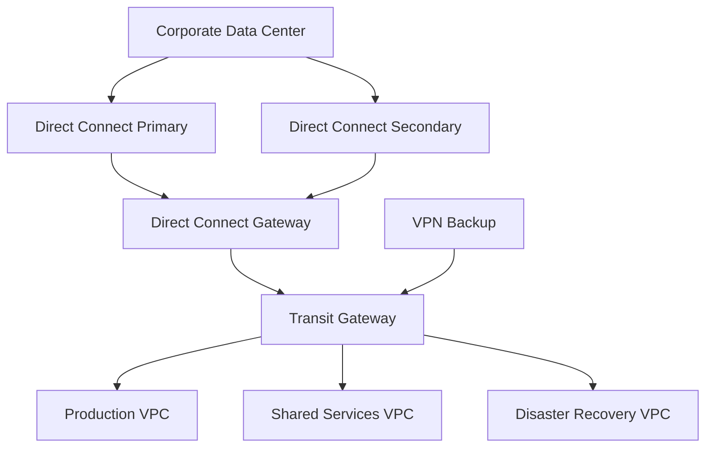

# Enterprise Direct Connect Hybrid Platform

Overview:

Enterprise hybrid connectivity architecture integrating on-premises data centers with AWS through Direct Connect, Direct Connect Gateway, Transit Gateway, Route53 Resolver, and VPN backup.

# Architecture

# Business Requirements

Private Connectivity
Redundant Routing
Regulatory Compliance
Disaster Recovery
Hybrid DNS

# Connectivity Design

Primary Path
Data Center

↓

Direct Connect

↓

DX Gateway

↓

Transit Gateway

↓

AWS Workloads

# Backup Path

Data Center

↓

VPN

↓

Transit Gateway

↓

AWS Workloads

# BGP Routing

Dynamic Route Advertisement
Route Propagation
Route Filtering
Route Summarization
Validation
DX Failure
Expected: Traffic moves to Secondary DX

Status: PASS

Dual DX Failure
Expected: Traffic switches to VPN

Status: PASS

BGP Failure
Expected: Route Withdrawal

Status: PASS

# Operational Runbooks

Direct Connect Failure

BGP Neighbor Down

DR Activation

DNS Failover

VPN Emergency Recovery

# AWS site-site VPN Troubleshooting Check list:

If you have an AWS Site-to-Site VPN where Tunnel 1 is UP and Tunnel 2 is DOWN, I would troubleshoot from both the AWS side and the customer gateway (on-premises firewall/router) side.

"When one AWS Site-to-Site VPN tunnel is up and the secondary tunnel is down.
I first verify the peer IP, PSK, IKE/IPsec proposals, and firewall connectivity (UDP 500, UDP 4500, ESP). 
Next, I check whether the tunnel fails during IKE negotiation, IPsec SA establishment, or BGP adjacency formation. 
I review customer gateway logs and AWS VPN tunnel logs in CloudWatch to identify proposal mismatches, authentication failures, routing issues, or blocked ports. Since AWS provides two tunnels for redundancy, I ensure both tunnels are independently configured according to the AWS-generated VPN configuration file."

# AWS direct connect Troubleshooting Check list:

Troubleshooting Flow:

On-Premises

     ↓

Direct Connect

     ↓

DX Gateway

     ↓

Transit Gateway / VGW

     ↓

VPC Route Tables

     ↓

Security Groups

     ↓

NACLs

     ↓
     
Private EC2 Instance

"I would troubleshoot the problem layer by layer. 
First, I'd verify the Direct Connect connection, Private VIF, and BGP session are operational. [DX connection status, Virtual Interface (Private VIF/Transit VTF) status,BGP status]
Then I'd validate route advertisements between on-premises and AWS through the Direct Connect Gateway and Transit Gateway or Virtual Private Gateway. 
Next, I'd inspect VPC route tables to ensure return routes exist to the on-premises network. 
After that, I'd verify EC2 security groups, subnet NACLs, and application-level connectivity on the instance. Finally, 
I'd use Reachability Analyzer and VPC Flow Logs to determine where traffic is being dropped. 
In my experience, the most common causes are missing route propagation, incorrect return routes, or security group restrictions."
