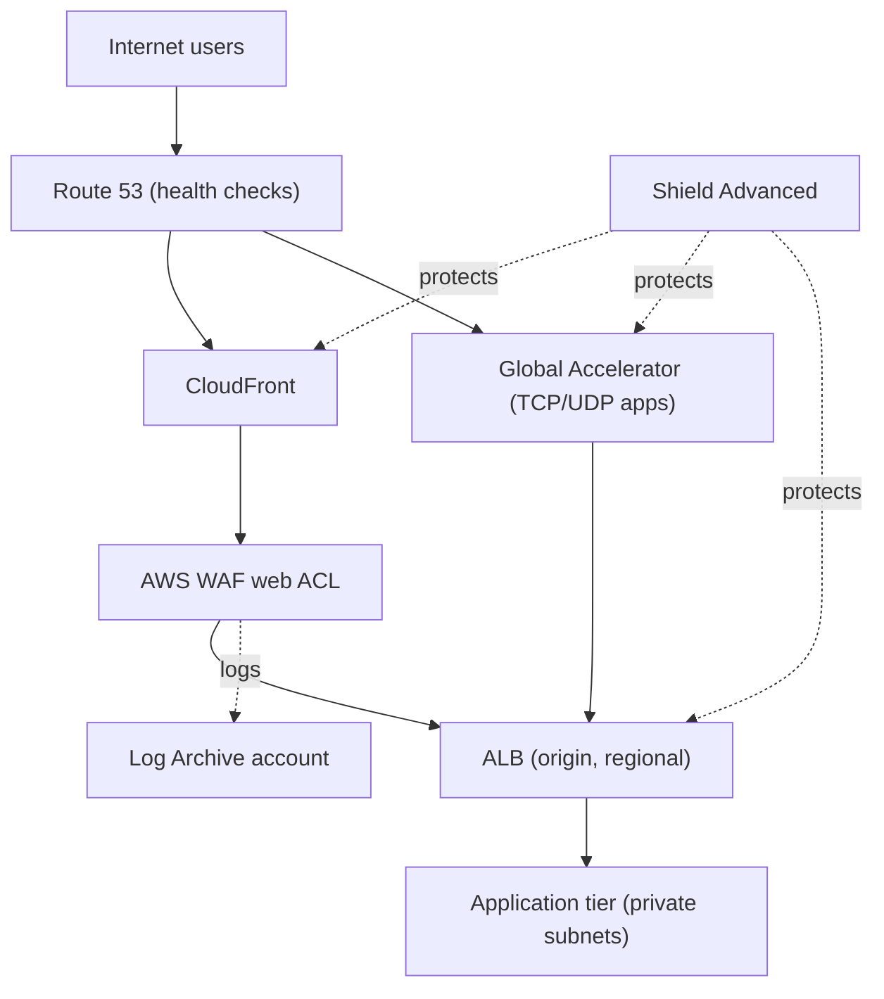

Enterprise Edge Security Architecture

## Objective

Protect internet-facing applications at the edge, before traffic reaches the VPC, and keep them reachable when a region or origin fails.

## Scope

| Layer | Service | Role |
|---|---|---|
| DNS | Route 53 | Health-checked and latency or failover routing |
| CDN / L7 edge | CloudFront | TLS termination, caching, origin shielding |
| App-layer filtering | AWS WAF | Managed, rate-based and geo rules |
| DDoS | Shield Advanced | L3/L4/L7 mitigation, DDoS response team, cost protection |
| Global TCP/UDP entry | Global Accelerator | Static anycast IPs, fast regional failover for non-HTTP workloads |
| Origin | ALB | Only accepts traffic from CloudFront or Global Accelerator |
| Policy | Firewall Manager | Applies WAF and Shield policy across accounts |
| Visibility | WAF logs to Log Archive account | Central, immutable logging |

## Architecture

## Design decisions

### 1. WAF rule design (evaluated top to bottom)

| Priority | Rule | Action | Purpose |
|---|---|---|---|
| 1 | IP allow list (partners, health checks) | Allow | Avoid blocking known-good sources |
| 2 | AWS IP reputation managed group | Block | Known bad sources |
| 3 | Geo match (blocked countries, per policy) | Block | Reduce exposure where there is no business need |
| 4 | Rate-based rule per IP | Block / Challenge | Mitigate L7 floods and brute force |
| 5 | Core rule set and known-bad-inputs managed groups | Block | SQL injection, XSS and common exploits |
| 6 | Custom rules (path or header specific) | Count, then Block | Application-specific tuning |

New rules start in **Count** mode, are reviewed against sampled requests, and then move to Block, to avoid false positives.

### 2. CloudFront or Global Accelerator

| Workload | Choice | Why |
|---|---|---|
| HTTP/S, cacheable content | CloudFront + WAF | Caching and L7 inspection at the edge |
| HTTP/S, dynamic APIs | CloudFront (no cache) + WAF | Edge TLS termination and filtering |
| TCP/UDP or fixed IP allow-listing | Global Accelerator | Static anycast IPs, fast failover, no L7 inspection |

### 3. Locking down the origin

- The ALB security group allows inbound only from the CloudFront managed prefix list, or from Global Accelerator for those workloads.
- CloudFront adds a secret header that the ALB listener rule checks, so direct hits on the ALB are rejected.
- Application instances sit in private subnets and accept traffic only from the ALB security group.

### 4. DDoS posture

- Shield Advanced is enabled on CloudFront distributions, Global Accelerator and ALBs.
- Rate-based WAF rules cover the application layer. Shield covers volumetric and protocol attacks.
- Shield alarms feed the incident runbook, and the DDoS response team is engaged through the support plan.

### 5. Traffic routing and resilience

- Route 53 health checks drive failover and latency routing between regional origins.
- Global Accelerator health checks shift TCP/UDP traffic between regional endpoints without waiting on DNS TTLs.
- CloudFront origin groups fail over to a secondary origin on 5xx responses.
- Recovery objectives are set per application tier, in the application DR plan.

### 6. Governance and logging

- Firewall Manager applies the baseline WAF and Shield policy across accounts, so teams cannot opt out.
- WAF logs are delivered to the Log Archive account for retention and investigation.
- Rules are changed only through Infrastructure as Code and pull requests.

## Constraints to note

- A WAF web ACL for CloudFront must be created in `us-east-1`. Regional resources such as ALB use a regional web ACL.
- Global Accelerator does not inspect L7 traffic, so it relies on the origin ALB's WAF.
- Shield Advanced is a paid subscription, so it is scoped to critical internet-facing resources.

## Validation plan (to prove in a sandbox)

- [ ] Direct request to the ALB is rejected, while the same request through CloudFront succeeds
- [ ] A known SQL injection pattern is blocked by the managed rule group
- [ ] The rate-based rule blocks a client that exceeds the threshold
- [ ] A geo-blocked test source is denied
- [ ] Route 53 failover shifts traffic when the primary origin health check fails
- [ ] WAF logs arrive in the Log Archive account

## Diagrams

- [Edge Security Flow](diagrams/Edge%20Security%20Flow.md)
- [WAF Inspection Flow](diagrams/WAF%20Inspection%20Flow.md)
- [DDoS Protection](diagrams/DDoS%20Protection.md)
- [Global Accelerator Design](diagrams/Global%20Accelerator%20Design.md)

## Related

- [`Accounts/Security-Account/WAF-Shield.md`](../../../Accounts/Security-Account/WAF-Shield.md)
- [`Organization/SCP-Strategy.md`](../../../Organization/SCP-Strategy.md)

