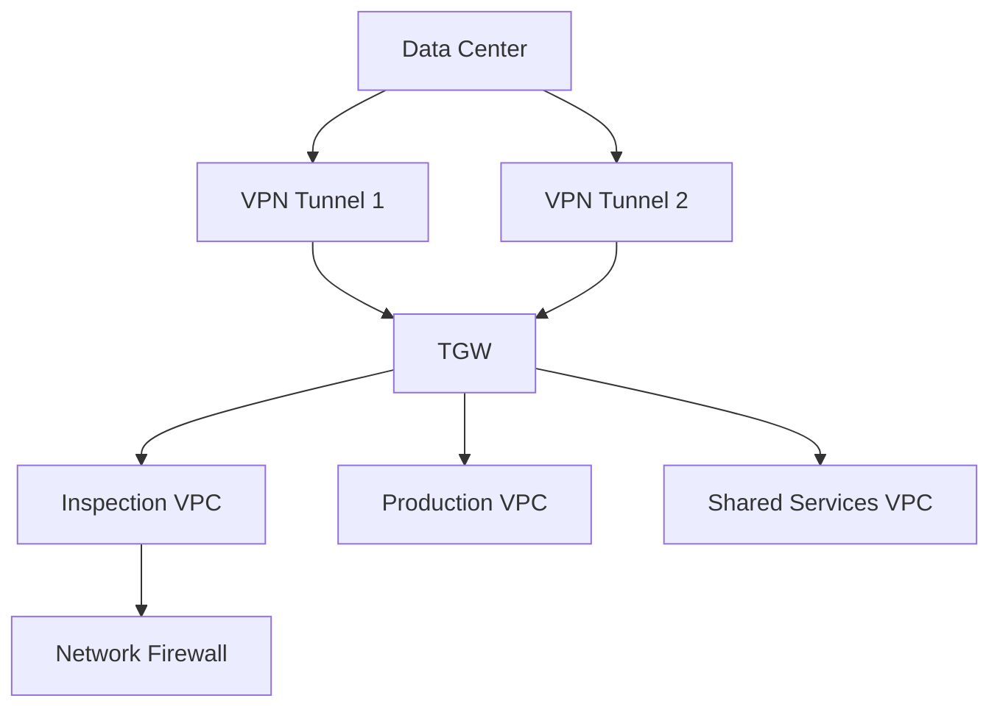

# Enterprise Hybrid Transit Network

# Overview:

Enterprise hybrid networking architecture connecting on-premises data centers to AWS using Transit Gateway, VPN, BGP, Gateway Load Balancer, and AWS Network Firewall.

# Architecture

# Objectives:

Hybrid Connectivity
Dynamic Routing
Centralized Inspection
High Availability
BGP Route Exchange

# Components:

Transit Gateway
Central Routing Hub

Site-to-Site VPN
Redundant IPSec tunnels

AWS Network Firewall
Traffic Inspection

Gateway Load Balancer
Third-party Security Appliance Integration

# Traffic Flow

On-Premises

↓

VPN

↓

Transit Gateway

↓

Inspection VPC

↓

AWS Network Firewall

↓

Application VPC

# Validation

Tunnel Failure
Expected: Traffic fails over to secondary tunnel

Result: PASS

Firewall Rule
Expected: Unauthorized traffic blocked

Result: PASS

# Quick Troubleshooting Checklist

 1. TGW Attachment Available
 2. Correct TGW Route Table Association
 3. Route Propagation Enabled
 4. Production CIDR Present in TGW Routes
 5. Return Route to Development Present
 6. VPC Route Tables Point to TGW
 7. Security Groups Allow Traffic
 8. NACLs Allow Forward and Return Traffic
 9. No Intentional TGW Segmentation Blocking Dev → Prod