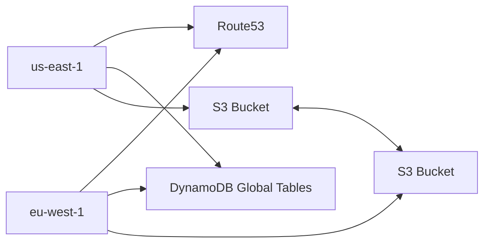

# Enterprise Multi-Region Disaster Recovery

# Overview:

Multi-region architecture supporting business continuity, disaster recovery, and application resilience.

# Architecture

# DR Strategy

Recovery Objective:

RTO: 15 Minutes

RPO: Near Zero

# Failover Process

Region Failure Detected
Route53 Health Check Fails
DNS Routing Updated
Traffic Redirected
Services Restored

# DR Testing

Primary Region Failure
Result: PASS

Database Replication
Result: PASS

Storage Replication
Result: PASS
